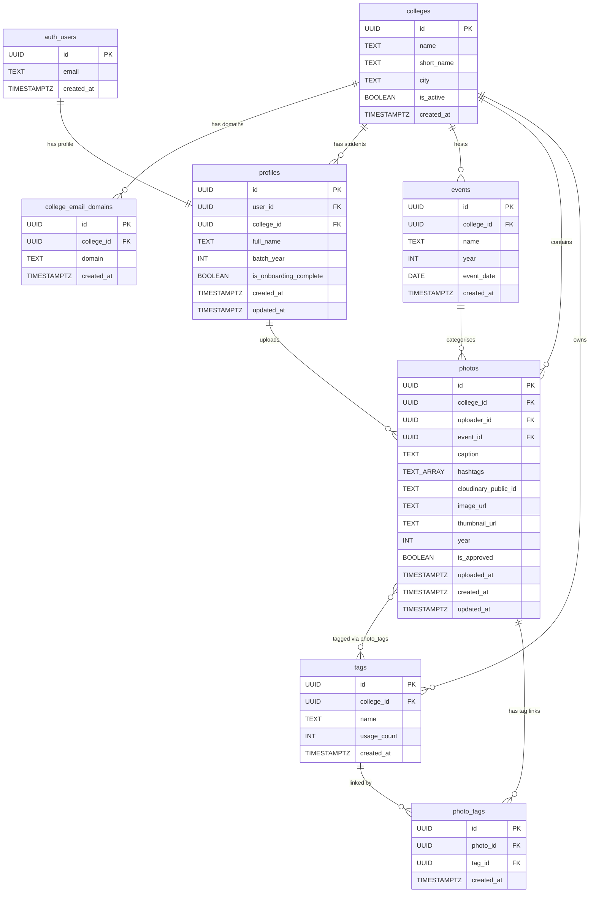

# CP2 — Entity-Relationship Diagram

## CampusLens — Full ER Diagram

---

## Relationship Descriptions

### auth_users — profiles (1:1)
Each Supabase auth user has exactly one profile row. The `profiles.user_id` column carries a UNIQUE constraint and a foreign key to `auth.users(id)`. This is a mandatory 1:1 relationship: a profile cannot exist without an auth user, and the application creates the profile row during onboarding.

### colleges — college_email_domains (1:N)
One college may have one or more registered email domains (e.g. Rishihood University has both `rishihood.edu.in` and `nst.rishihood.edu.in`). The `domain` column is globally UNIQUE, so a domain cannot belong to two colleges simultaneously.

### colleges — profiles (1:N)
One college has many student profiles. `profiles.college_id` is set during onboarding to the college whose domain matched the student's email. The relationship is nullable: `college_id` is NULL until onboarding completes.

### colleges — events (1:N)
One college owns many events (e.g. "Damru 2026", "Hack Night 2025"). Events are scoped to a single college and are not shared across colleges. Deleting a college cascades to its events.

### colleges — photos (1:N)
`photos.college_id` directly links every photo to its owning college. This is a controlled denormalization (the same information is derivable via `photos.uploader_id → profiles.college_id`) kept for multi-tenant Row Level Security performance.

### colleges — tags (1:N, nullable)
Tags are optionally scoped to a college. A tag with `college_id IS NULL` is a global tag. In practice the application always creates college-scoped tags, so this relationship is effectively 1:N with the NULL case reserved for future global tags.

### profiles — photos (1:N)
One student may upload many photos. `photos.uploader_id` references `profiles(id)`. Deleting a profile cascades to all photos they uploaded.

### events — photos (1:N, optional)
`photos.event_id` is nullable. A photo may optionally be associated with an event; a photo without an event association has `event_id = NULL`. Deleting an event sets `photos.event_id` to NULL (SET NULL), preserving the photo.

### photos — tags (M:N via photo_tags)
This is the core many-to-many relationship. One photo can be tagged with many tags; one tag can appear on many photos. The junction table `photo_tags` resolves this relationship, enforcing no duplicate links via `UNIQUE(photo_id, tag_id)`.

### photo_tags — photos / tags (N:1 each)
`photo_tags` is the associative entity resolving the photos↔tags many-to-many. Each row in `photo_tags` holds exactly one `photo_id` and one `tag_id`. Deleting either the photo or the tag cascades to remove all associated `photo_tags` rows.

---

## Cardinality & Participation Constraints Summary

| Entity 1 | Entity 2 | Cardinality | Entity 1 Participation | Entity 2 Participation | FK Placement & Integrity Rule |
|---|---|---|---|---|---|
| `auth.users` | `profiles` | 1 : 1 | Partial (pre-onboarding) | Total | `profiles.user_id` (UNIQUE, ON DELETE CASCADE) |
| `colleges` | `college_email_domains` | 1 : N | Partial | Total | `college_email_domains.college_id` (ON DELETE CASCADE) |
| `colleges` | `profiles` | 1 : N | Partial | Partial (pre-onboarding) | `profiles.college_id` (ON DELETE RESTRICT) |
| `colleges` | `events` | 1 : N | Partial | Total | `events.college_id` (ON DELETE CASCADE) |
| `colleges` | `photos` | 1 : N | Partial | Total | `photos.college_id` (ON DELETE CASCADE) |
| `colleges` | `tags` | 1 : N | Partial | Partial (nullable for global) | `tags.college_id` (ON DELETE CASCADE) |
| `profiles` | `photos` | 1 : N | Partial | Total | `photos.uploader_id` (ON DELETE CASCADE) |
| `events` | `photos` | 1 : N | Partial | Partial (optional fest link) | `photos.event_id` (ON DELETE SET NULL) |
| `photos` | `tags` | M : N | Partial | Partial | Resolved via `photo_tags(photo_id, tag_id)` |

---

## Relational Schema Mapping (Physical Schema Representation)

Below is the formal relational schema derived from the ER model:

- **`colleges`** (<u>id</u>, name, short_name, city, is_active, created_at)
- **`college_email_domains`** (<u>id</u>, *college_id*, domain, created_at)
  - FK: `college_id` $\to$ `colleges(id)`
- **`profiles`** (<u>id</u>, *user_id*, *college_id*, full_name, batch_year, is_onboarding_complete, created_at, updated_at)
  - FK: `user_id` $\to$ `auth.users(id)`
  - FK: `college_id` $\to$ `colleges(id)`
- **`events`** (<u>id</u>, *college_id*, name, year, event_date, created_at)
  - FK: `college_id` $\to$ `colleges(id)`
- **`photos`** (<u>id</u>, *college_id*, *uploader_id*, *event_id*, caption, hashtags, cloudinary_public_id, image_url, thumbnail_url, year, is_approved, uploaded_at, created_at, updated_at)
  - FK: `college_id` $\to$ `colleges(id)`
  - FK: `uploader_id` $\to$ `profiles(id)`
  - FK: `event_id` $\to$ `events(id)`
- **`tags`** (<u>id</u>, *college_id*, name, usage_count, created_at)
  - FK: `college_id` $\to$ `colleges(id)`
- **`photo_tags`** (<u>id</u>, *photo_id*, *tag_id*, created_at)
  - FK: `photo_id` $\to$ `photos(id)`
  - FK: `tag_id` $\to$ `tags(id)`

